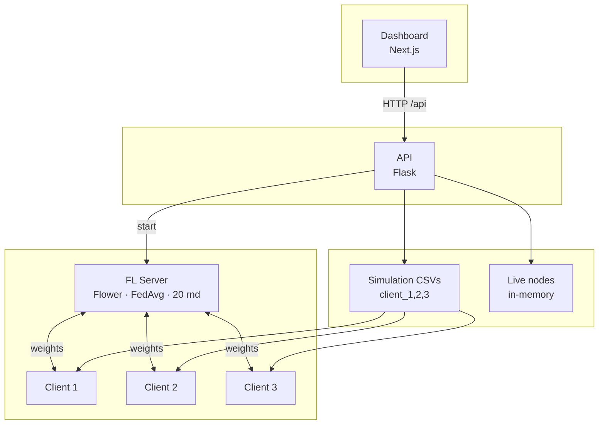

# ChatGPT / DALL·E Image Prompt — FedGrid System Architecture

Use the prompt below in **ChatGPT (with image generation)** or any text-to-image tool to generate a diagram of the FedGrid architecture.

---

## Prompt (copy-paste)

```
Create a clean, professional technical architecture diagram for a federated learning smart grid system. Style: flat 2D, light background, dark text, simple shapes and arrows. No 3D or photos.

Layout from TOP to BOTTOM in 5 horizontal layers. Each layer is a horizontal band with a label and 1–3 boxes:

1) TOP – DASHBOARD: one rectangle labeled "Dashboard (Next.js)". Below it a small caption: "Live nodes, metrics, rounds, prediction".

2) Second – API: one rectangle labeled "API (Flask)". Caption: "REST: /nodes, /metrics, /prediction, /api/rounds, simulation start, FL rerun".

3) Third – DATA LAYER: one rectangle labeled "Data layer". Inside show: "Simulation CSVs (client_1,2,3)" and "Live nodes (in-memory)". Optional: small icons for "file" and "memory".

4) Fourth – FL SERVER: one rectangle labeled "FL Server (Flower)". Caption: "FedAvg, 20 rounds, port 8085".

5) BOTTOM – FL CLIENTS: three equal small rectangles in a row, labeled "FL Client 1", "FL Client 2", "FL Client 3". Below them: "Local LSTM training, send weights".

Vertical arrows between layers:
- Arrow down from Dashboard to API: "HTTP /api".
- Arrow down from API to Data layer: "read/write".
- Arrow down from API to FL Server: "start".
- Arrow down from FL Server to FL Clients: "gRPC, weights".
- Optional: arrow from Data layer to FL Clients: "client_1..3.csv".

Use a simple color scheme: light blue or light gray for boxes, dark blue or black for text, black or dark gray for arrows. Minimal, suitable for a technical report or slide.
```

---

## Shorter variant (if character limit)

```
Technical diagram: 5 horizontal layers (top to bottom). 1) Dashboard (Next.js). 2) API (Flask). 3) Data layer (CSV + in-memory nodes). 4) FL Server (Flower, FedAvg). 5) Three FL Clients. Arrows: Dashboard→API (HTTP), API→Data, API→FL Server, FL Server↔FL Clients (weights). Flat 2D, light background, dark text, clean and minimal.
```

---

## Alternative: Mermaid (for docs or GitHub)

You can also render an architecture diagram with **Mermaid** (e.g. in GitHub, Notion, or [mermaid.live](https://mermaid.live)):



Copy the Mermaid block into any Markdown file or the Mermaid live editor to get a diagram without using an image generator.
