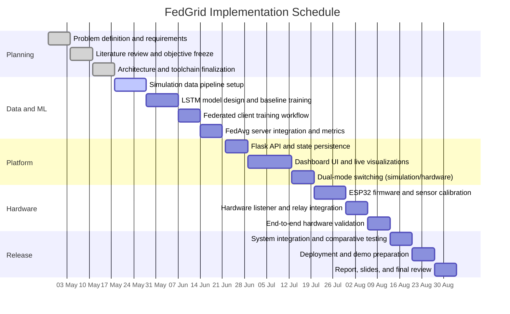

# FedGrid Project Gantt Chart

This schedule maps directly to the current FedGrid scope: privacy-preserving demand forecasting, federated LSTM training, dual-mode data ingestion, ESP32 smart meter integration, dashboard delivery, and deployment.

Start date used below: `2026-04-27`.

## Workstream Summary

| Phase | Main outputs |
|------|--------------|
| Planning | Project scope, objectives, architecture, technology selection |
| Data and ML | Synthetic or CSV data flow, LSTM forecasting model, FL training loop, FedAvg rounds |
| Platform | Flask API, persisted FL state, dashboard metrics, live node monitoring |
| Hardware | ESP32 meter firmware, telemetry ingestion, relay path, sensor validation |
| Release | Integration testing, deployment, documentation, viva/demo assets |

## Notes

- This is a **16-week academic project plan** tailored to the current repository structure.
- If your semester dates differ, keep the task order and shift the start date from `2026-04-27`.
- Mermaid charts render directly on GitHub and in many Markdown viewers.
